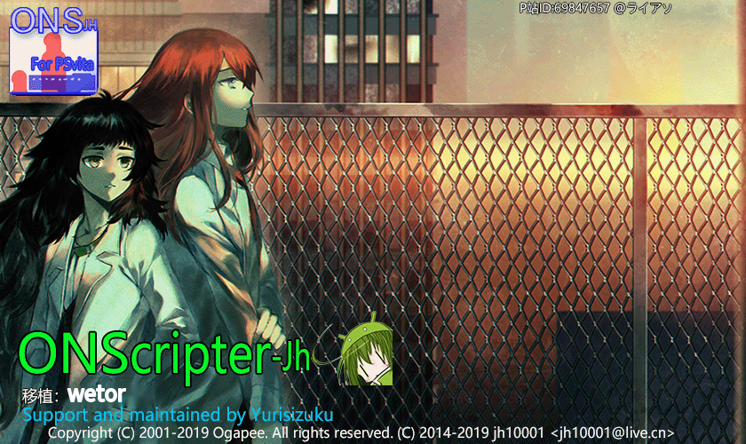

# ONScripter-jh-PSVita (yuri)

  

ONScripter JH（SDL2 版）を PlayStation Vita へ移植したプロジェクトです。  
Yurisizuku が保守を行い、コード構成の最適化や機能追加（動画のハードウェアデコード、nt2 / nt3 形式への対応など）を行っています。

本リポジトリでは UI・メニュー・ドキュメントを完全に日本語化し、日本語のノベルゲームがそのまま表示できるように調整しています。

- [x] CMake による分かりやすい構成
- [x] 新しい vitasdk でのビルド不具合と描画不具合の修正
- [x] ジョイスティック／タッチ操作の不具合修正（Y 方向の拡大率が原因）
- [x] GitHub Actions による自動ビルド
- [x] nt2 / [nt3](https://github.com/YuriSizuku/GalgameReverse/blob/master/src/onscripter/ons_decryptnt3.c) スクリプト形式への対応
- [x] ハードウェアデコードによる AVC 動画の再生
- [x] メニューの日本語化
- [x] 日本語フォント（Noto Sans JP）の同梱と、ゲーム側フォントが無い場合のフォールバック
- [ ] 動作確認済みゲームリストの整備
- [ ] その他の改善（随時追加）




エミュレータ向けの別 MOD はこちらです。  
[Mine_v1.5_yuri（Android 版）](https://github.com/YuriSizuku/Kirikiroid2/releases/download/1.3.9_yuri/Kirikiroid2_yuri_1.3.9.apk)  
[Kirikiroid2（Android 版）](https://github.com/YuriSizuku/Kirikiroid2/releases/download/1.3.9_yuri/Kirikiroid2_yuri_1.3.9.apk)

## 1. ビルド

先に [vitasdk](https://vitasdk.org/) をインストールし、付属のスクリプトでビルド・転送を行います。  
Windows の MSYS `sh` と Linux の `bash` で動作確認しています。

```sh
# vitasdk のインストール
sh ./script/install_vitasdk.sh [vitasdkdir]

# ビルド
sh ./script/build_vitavpk.sh vpk [vitasdkdir]

# Vita への転送
sh send_vitavpk.sh ./../build/vita_onscripter.vpk 10.2.12.6 PSVONSEMU
sh build_vitavpk.sh all && sh send_vitaeboot.sh 10.2.12.6
```

## 2. 使い方

ONS 形式のゲームを `ux0:onsemu/` に配置して起動してください。  
`ur0:onsemu/` と `uma0:onsemu/` も検索対象です。

> **注意**
> ゲームのフォルダ名には日本語や記号など、ASCII 以外の文字を使わないでください。  
> フォルダ名が原因でゲームが認識されない場合があります。

### 日本語表示について

本バージョンでは、日本語のノベルゲームを快適に遊べるように次の設定を適用しています。

- スクリプトの文字コードは **Shift-JIS（SJIS）を既定** に設定
- セーブ／ロードなどのゲーム内メニューを日本語で表示
- 日本語フォント **Noto Sans JP** を同梱
- ゲーム側に `default.ttf` が無い場合は、同梱フォント（`app0:default.ttf`）を自動で使用
- ショートカット（起動バブル）を作成した場合も、同梱フォントが自動的にコピーされます

ゲーム側に `default.ttf` がある場合は、そのフォントを優先します。  
日本語の文字化けが起こる場合は、ゲームのスクリプトが Shift-JIS で保存されているか確認してください。

### 動画について

PS Vita のハードウェアデコーダーが再生できるのは `avc yuv420p, aac, mp4` 形式のみです。  
それ以外の形式の動画は、あらかじめ変換しておく必要があります。  
（デコードに失敗する場合は、動画ファイルを削除してもゲームを続行できます。）

本エンジンは、まず同じ名前で拡張子が `.mp4` の動画を探して再生します。

```sh
ffmpeg -i op.mpg -c:v libx264 -c:a aac -pix_fmt yuv420p op.mp4
```


## 3. 操作

ゲーム内の操作は次のとおりです。

| ボタン | 動作 |
| --- | --- |
| ○ | 決定／次へ |
| ×（長押し） | スキップ |
| □ | オートモード |
| △ | メニュー／回想モードを閉じる |
| L | 現在のページをスキップ |
| R | スキップの開始／停止 |
| ← → | 回想モードの選択 |
| ↑ ↓ | 選択肢／ボタンの移動 |
| 左スティック | 方向キーと同じ |

ランチャー画面では次の操作ができます。

| ボタン | 動作 |
| --- | --- |
| L | 設定メニュー |
| R | ヘルプ |
| Select | このアプリについて |
| ○ | 決定 |
| × | 戻る／キャンセル |

## 4. 既知の問題（解決済みのものを含む）

- [x] CMake 3.24.2 でターゲット名が `onsjh.self-self` のように壊れる  
  → CMake 3.16.x を使用するか、[vita-toolchain の修正](https://github.com/vitasdk/vita-toolchain/issues/215)を適用してください。
- [x] 一部のゲームで `*** can't load file [fgimage/CGTM16.png] Out of memory ***` が発生する  
  → Vita のホームブリュー用ヒープサイズが 32MB に制限されているためです。[sbrk の上書き](https://gitee.com/yizhigai/onscripter-vita/blob/master/onscripter/vita/sbrk.c)で解決しています。

## 5. 設定ファイル

ランチャーの設定は `ux0:data/onsemu/ONSConfig.ini` に保存されます。  
ゲームごとの起動オプションは、各ゲームフォルダ内の `sittings.txt` に保存されます。

主な設定項目は次のとおりです。

- 表示モード（アイコン／リスト）
- 方向キーのみで操作するか
- アイコン／リストの行数・列数
- タッチ操作の有効範囲（前面のみ／前後面）
- 全画面表示、フォントキャッシュ、文字の影、テキストボックス表示

## 6. オリジナル情報

以下は [wetor](https://github.com/wetor/ONScripter-jh-PSVita) 氏によるオリジナルプロジェクトの情報を日本語に翻訳したものです。  
コードと Makefile を公開してくださったことに感謝します。

### 2019.3.3 一部ソースコードを公開

現在はまだコンパイルできません。ソースコードは整理中です。  
GUI のソースコード（かなり乱雑です）と Makefile は整理が終わり次第公開します。  
大学の課題で忙しいため、更新までしばらくお待ちください。

### 詳細情報

- [beta0.2 版ダウンロード](https://blog.wetorx.cn/posts/ONS-PSV/)
- [更新履歴](https://blog.wetorx.cn/posts/ONS-PSV/)
- [現在の既知の不具合一覧](https://blog.wetorx.cn/posts/ONS-PSV/)

### 謝辞

- 小凱（@kane33936）氏、長年にわたるご支援に感謝します。
- jh10001 氏、私の稚拙な質問に丁寧に答えてくださりありがとうございました。
- 唯一氏、小凱氏、光影氏、初期テストにご協力いただきありがとうございました。

## 7. ソースコード・クレジット

- ONScripter-jh 作者: jh10001（@jh2711H）
- SDL2-Vita および SDL2 関連ライブラリ（ttf、mixer、image）作者: rsn8887
- VitaShell 作者: TheOfficialFloW（TheFlow）
- vita-savemgr 作者: d3m3vilurr
- vhbb 作者: devnoname120
- vitacompanion 作者: devnoname120
- debugnet 作者: psxdev
- sdlpal-vita 作者: usineur
- iniparser 作者: ndevilla
- libvita2d 作者: xerpi
- vita-luajit 作者: hyln9
- VITASDK
- Vita3K
- Noto Sans JP（SIL Open Font License 1.1）

その他、多数の皆様に感謝します。

## 8. ライセンス

- 本体のソースコードは **GNU General Public License v2** に従います。詳細は [license/COPYING](license/COPYING) を参照してください。
- 同梱フォント **Noto Sans JP** は **SIL Open Font License 1.1** に従います。詳細は [license/OFL-NotoSansJP.txt](license/OFL-NotoSansJP.txt) を参照してください。
- 画像などのアセットには [license/license.txt](license/license.txt) の条件が適用されます。